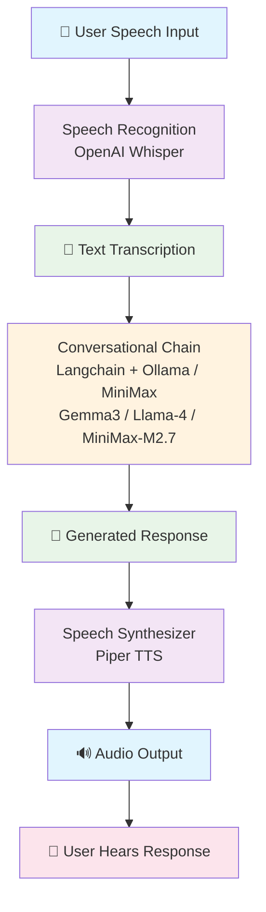

## Build your own voice assistant and run it locally: Whisper + Ollama + Piper

> Original article: https://blog.duy-huynh.com/build-your-own-voice-assistant-and-run-it-locally/
>
> Uses [Piper](https://github.com/OHF-Voice/piper1-gpl) for fast, local text-to-speech, including on 64-bit Raspberry Pi OS.
>
> The original implementation using Bark has been preserved in the `archive-2025-05-29` branch for reference.

[](https://www.buymeacoffee.com/vndee)


After my latest post about how to build your own RAG and run it locally. Today, we're taking it a step further by not only implementing the conversational abilities of large language models but also adding listening and speaking capabilities. The idea is straightforward: we are going to create a voice assistant reminiscent of Jarvis or Friday from the iconic Iron Man movies, which can operate offline on your computer.

Piper runs locally and offers downloadable voices in multiple languages and sizes.

### Techstack
First, you should set up a virtual Python environment. You have several options for this, including pyenv, virtualenv, poetry, and others that serve a similar purpose. Personally, I'll use Poetry for this tutorial due to my personal preferences. Here are several crucial libraries you'll need to install:

- **rich**: For a visually appealing console output.
- **openai-whisper**: A robust tool for speech-to-text conversion.
- **piper-tts**: Local neural text-to-speech with downloadable voice models.
- **langchain**: A straightforward library for interfacing with Large Language Models (LLMs).
- **langchain-openai**: For connecting to OpenAI-compatible cloud LLM providers like [MiniMax](https://www.minimaxi.com).
- **sounddevice**, **pyaudio**, and **speechrecognition**: Essential for audio recording and playback.

For a detailed list of dependencies, refer to the link here.

The most critical component here is the Large Language Model (LLM) backend. By default, we use **Ollama** for running LLMs locally. Alternatively, you can use **MiniMax** as a cloud LLM provider for higher-quality responses without local GPU requirements. If Ollama is new to you, I recommend checking out my previous article on offline RAG: "Build Your Own RAG and Run It Locally: Langchain + Ollama + Streamlit". Basically, you just need to download the Ollama application, pull your preferred model, and run it.

### Architecture
Okay, if everything has been set up, let's proceed to the next step. Below is the overall architecture of our application, which fundamentally comprises 3 main components:

- **Speech Recognition**: Utilizing OpenAI's Whisper, we convert spoken language into text. Whisper's training on diverse datasets ensures its proficiency across various languages and dialects.
- **Conversational Chain**: For the conversational capabilities, we'll employ the Langchain interface with a pluggable LLM backend — either a local model via Ollama (e.g., Gemma3, Llama-4) or a cloud model via [MiniMax](https://www.minimaxi.com) (MiniMax-M2.7). This setup promises a seamless and engaging conversational flow.
- **Speech Synthesizer**: Piper converts the response to speech using a local voice model.

The workflow is straightforward: record speech, transcribe to text, generate a response using an LLM, and vocalize the response using Piper.



### Installation

**⚠️ Important**: We strongly recommend using [uv](https://docs.astral.sh/uv/) for dependency management instead of pip with `requirements.txt`. The `requirements.txt` file was generated by `uv pip freeze` and contains pinned versions that may not install correctly across different systems.

#### Option 1: Using uv (Recommended)

```bash
# Install uv if you haven't already
curl -LsSf https://astral.sh/uv/install.sh | sh
# or on macOS: brew install uv
# or on Windows: powershell -ExecutionPolicy ByPass -c "irm https://astral.sh/uv/install.ps1 | iex"

# Clone the repository
git clone https://github.com/vndee/local-talking-llm.git
cd local-talking-llm

# Install dependencies using uv (recommended)
uv sync

# Download the default Piper voice into the ignored models/piper directory
uv run python -m piper.download_voices --data-dir models/piper en_US-lessac-medium
```

#### Option 2: Using pip (Alternative)

If you prefer to use pip, install directly from pyproject.toml:

```bash
# Clone the repository
git clone https://github.com/vndee/local-talking-llm.git
cd local-talking-llm

# Create virtual environment
python -m venv venv
source venv/bin/activate  # On Windows: venv\Scripts\activate

# Install from pyproject.toml (NOT requirements.txt)
pip install -e .

# Download the default Piper voice into the ignored models/piper directory
python -m piper.download_voices --data-dir models/piper en_US-lessac-medium
```

#### Install and Setup Ollama

```bash
# Install and start Ollama
# Follow instructions at https://ollama.ai
ollama pull gemma3  # or any other model you prefer
```

#### Setup MiniMax (Cloud LLM Alternative)

If you don't have a local GPU or prefer higher-quality cloud models, you can use [MiniMax](https://www.minimaxi.com) as the LLM backend:

1. Sign up at [MiniMax Platform](https://www.minimaxi.com) and get your API key
2. Set the environment variable:
   ```bash
   export MINIMAX_API_KEY="your-api-key-here"
   ```

No Ollama installation is needed when using MiniMax — the LLM runs in the cloud while TTS and STT still run locally.

### Usage

Piper needs a voice model. If you have not downloaded one during installation, run:

```bash
uv run python -m piper.download_voices --data-dir models/piper en_US-lessac-medium
```

#### Basic Usage
```bash
uv run python app.py
```

#### With a Different Piper Voice

Download a voice from the [Piper voice list](https://github.com/OHF-Voice/piper1-gpl/blob/main/docs/VOICES.md), then pass its ONNX model path:

```bash
uv run python -m piper.download_voices --data-dir models/piper en_US-amy-medium
uv run python app.py --piper-model models/piper/en_US-amy-medium.onnx
```

#### With Custom Settings
```bash
# Use a different LLM model
uv run python app.py --model codellama

# Save generated voice samples
uv run python app.py --save-voice
```

#### With MiniMax Cloud LLM
```bash
# Use MiniMax as the LLM provider (requires MINIMAX_API_KEY env var)
python app.py --provider minimax

# Use a specific MiniMax model with custom temperature
python app.py --provider minimax --model MiniMax-M2.7 --temperature 0.8

# Pass API key directly
python app.py --provider minimax --api-key your-api-key-here

uv run python app.py --provider minimax --piper-model models/piper/en_US-amy-medium.onnx
```

### Configuration Options

- `--provider`: LLM provider (`ollama` or `minimax`, default: ollama)
- `--api-key`: API key for cloud LLM providers (or use `MINIMAX_API_KEY` env var)
- `--temperature`: LLM temperature (0.0-1.0, default: 0.7)
- `--piper-model`: Path to a downloaded Piper ONNX voice model (default: `models/piper/en_US-lessac-medium.onnx`)
- `--model`: Ollama model to use (default: llama2)
- `--save-voice`: Save generated audio responses to `voices/` directory

### Tips for Best Results

1. **Raspberry Pi**: Use 64-bit Raspberry Pi OS and a small Piper voice (for example, `en_US-lessac-medium`).
2. **Performance**: Consider a smaller Whisper model ("tiny.en" or "base.en") on lower-powered devices.
3. **Audio**: Connect a USB microphone and speaker, and check the system's audio-device permissions.

#### Raspberry Pi

Use 64-bit Raspberry Pi OS, install the project with `uv sync`, then download a Piper voice as shown above. A USB microphone and speaker are recommended. Smaller Whisper and Piper voice models will be faster on lower-memory Pi models.

### Scaling to Production

For those aiming to elevate this application to a production-ready status, consider:

- **Performance Optimization**:
  - Use optimized inference engines (ONNX, TensorRT)
  - Implement model quantization for faster inference
  - Add caching for frequently used phrases

- **Enhanced Features**:
  - Multi-speaker support with voice profiles
  - Real-time voice conversion
  - Integration with more LLM providers
  - Web interface with real-time streaming

- **Voice Database**:
  - Create a library of voice samples
  - Implement voice selection UI
  - Add voice mixing capabilities

- **API Service**:
  - RESTful API for TTS requests
  - WebSocket support for real-time communication
  - Rate limiting and authentication

### Troubleshooting

#### Dependency Installation Issues

**Problem**: Installing pinned requirements fails with errors like:
- `ERROR: Could not find a version that satisfies the requirement cPython==0.0.6`
- `ModuleNotFoundError: No module named 'distutils'`
- Various version conflicts

**Solution**: Prefer the cross-platform dependency definitions in `pyproject.toml` rather than installing platform-specific pins:

1. **Use uv (Recommended)**:
   ```bash
   uv sync
   ```

2. **Use pip with pyproject.toml**:
   ```bash
   pip install -e .
   ```

3. **Manual installation of core packages**:
   ```bash
   pip install piper-tts langchain-ollama openai-whisper sounddevice rich
   ```

#### Runtime Issues

- **Piper voice model not found**: Download a voice with `python -m piper.download_voices --data-dir models/piper en_US-lessac-medium`
- **Microphone not working**: Check system permissions and device settings
- **Slow inference**: Try smaller Whisper and Piper voice models
- **Import errors**: Run the app with `uv run` or activate the virtual environment first

### Conclusion

Piper provides local text-to-speech using downloadable voice models, making it a practical choice for running the assistant on a Raspberry Pi.

With Whisper, Ollama, and Piper, speech recognition, conversation, and speech synthesis can all run locally. The MiniMax provider remains available as an optional cloud LLM.

### Resources

- [Piper GitHub](https://github.com/OHF-Voice/piper1-gpl)
- [Ollama](https://ollama.ai)
- [MiniMax Platform](https://www.minimaxi.com)
- [Whisper](https://github.com/openai/whisper)
- [Original Blog Post](https://blog.duy-huynh.com/build-your-own-voice-assistant-and-run-it-locally/)

---

